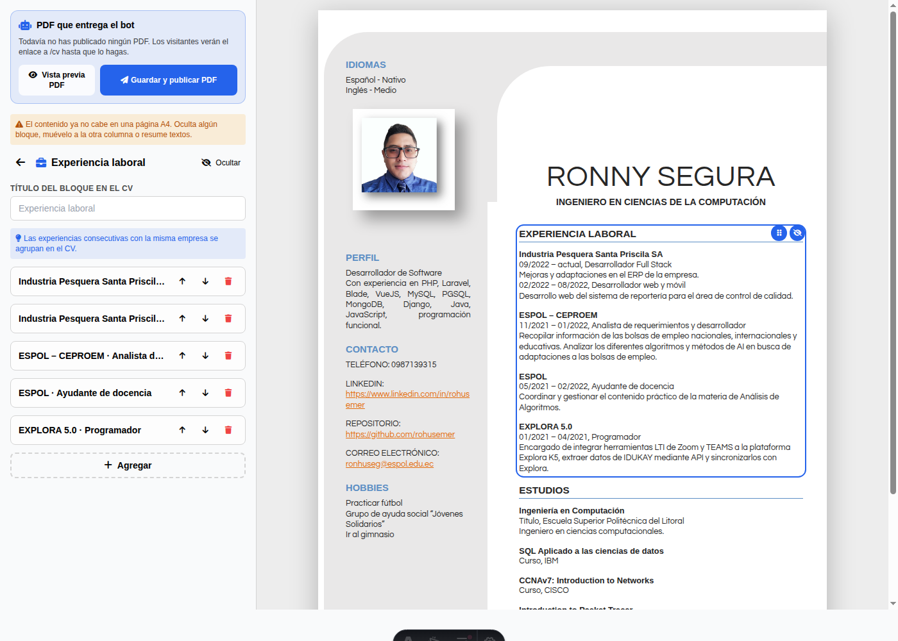

<div align="center">

# Ronny Segura · Portafolio y CV

**Ingeniero en Ciencias de la Computación · Desarrollador Full Stack**

[](https://portfoliowebsite-ccc81.web.app)
[](https://portfoliowebsite-ccc81.web.app/cv)
[](https://www.linkedin.com/in/rohusemer)


Portafolio personal con **constructor visual de CV**, **edición en vivo** protegida por roles y un **bot asistente**
que responde a reclutadores y les entrega el CV en PDF.

</div>

---


## ✨ Funcionalidades

| | |
|---|---|
| 🌐 **Portafolio público** | Perfil, habilidades, experiencia, estudios y proyectos en una línea de tiempo animada, con modo oscuro. |
| 🤖 **Bot asistente** | Responde preguntas sobre mi experiencia y tecnologías (*"¿sabe React?"*), **entrega el CV en PDF** y recoge mensajes de contacto. |
| 🧩 **Constructor de CV** | Arrastrar y soltar bloques entre columnas, ocultarlos, renombrarlos, crear bloques propios y cambiar el color. Vista A4 en vivo con aviso si el contenido no cabe en una página. |
| 📄 **PDF publicado** | Un clic en *"Guardar y publicar PDF"* genera el CV y lo deja listo para que el bot lo entregue. |
| ✏️ **Edición en vivo** | Al iniciar sesión como admin aparece un botón *Editar* en cada sección del portafolio. |
| 👥 **Usuarios y roles** | Cualquiera se registra con Google. El propietario ve quién se registró y asigna roles (`owner`, `editor`, `user`, `blocked`). |
| 🪪 **CV para cada usuario** | Cada usuario registrado tiene su propio espacio en `/mi-cv` para editar su información, armar su CV con el constructor y descargarlo en PDF. |
| 📬 **Bandeja de mensajes** | Los mensajes que dejan los visitantes llegan al panel `/admin` con un contador de no leídos. |
| 📝 **Markdown en todo** | Las descripciones se escriben en Markdown y el CV se exporta también como `.md` o JSON. |

<table>
<tr>
<td width="62%"><br><sub><b>Constructor de CV</b>: bloques arrastrables y editor del bloque seleccionado</sub></td>
<td width="38%"><br><sub><b>CV en PDF</b> (A4, una página)</sub></td>
</tr>
</table>

## 🗺️ Rutas

| Ruta | Quién | Qué hace |
|---|---|---|
| `/` | Todos | Portafolio y bot. Con sesión de admin activa: **modo edición**. |
| `/cv` | Todos | El CV en línea, con descarga en PDF (el publicado), impresión y exportación a Markdown. |
| `/mi-cv` | Usuarios registrados | Su propio CV: información, diseño con arrastrar y soltar, y descarga en PDF/Markdown. |
| `/admin` | Owner / Editor | **Constructor de CV**, **Contenido web**, **Mensajes** y, solo para el owner, **Usuarios**. |

## 🔐 Roles

| Rol | Portafolio y PDF del bot | Mensajes | Usuarios y roles | Su propio CV (`/mi-cv`) |
|---|:-:|:-:|:-:|:-:|
| `owner` | ✅ | ✅ | ✅ (y ver/descargar el CV de cada usuario) | ✅ |
| `editor` | ✅ | ✅ | — | ✅ |
| `user` | — | — | — | ✅ |
| `blocked` | — | — | — | — |

Al iniciar sesión por primera vez se crea `users/{uid}` con el rol `user`. Las reglas de Firestore impiden que alguien
cambie su propio rol: solo un `owner` puede hacerlo.

## 🏗️ Arquitectura

```
Visitante ──► Firebase Hosting (Astro estático)
                 │
                 ├── Portafolio / CV ──────► Firestore: portfolio/main      (lectura pública)
                 ├── Bot ── "dame el CV" ──► Firestore: cvPdf/current/chunks (lectura pública)
                 │      └─ formulario ─────► Firestore: messages            (solo crear)
                 │
Usuario ──► Google Sign-In ──► Firestore: users/{uid}.role
                                   ├── user   → profiles/{uid} (su propio CV)
                                   ├── editor → + portfolio, cvPdf, messages
                                   └── owner  → + gestión de users y lectura de profiles
```

- **Contenido**: un único documento `portfolio/main`. Si no existe, el sitio usa la semilla [`frontend/src/data/portfolio.json`](frontend/src/data/portfolio.json), por lo que nunca se ve vacío.
- **PDF**: se genera en el navegador del admin (html-to-image + jsPDF) y se guarda en Firestore dividido en trozos de 700 KB. No usa Firebase Storage, así que funciona en el plan gratuito.
- **Rendimiento**: los visitantes no descargan Firebase Auth, el editor ni el generador de PDF. Se cargan solo cuando hacen falta.
- **Bot**: funciona por reglas y palabras clave sobre los datos del portafolio (sin IA ni costo). Las respuestas personalizadas se editan desde `/admin`.

### Estructura

```
├── firebase.json            # Hosting + reglas
├── firestore.rules          # Modelo de permisos por rol
├── scripts/test-firestore-rules.mjs   # 20 pruebas de las reglas (emulador)
├── frontend/
│   ├── src/data/portfolio.json        # Contenido inicial (semilla)
│   ├── src/lib/                       # Firebase, sesión, Markdown, PDF, cerebro del bot
│   ├── src/components/react/
│   │   ├── PortfolioSections.tsx      # Secciones públicas + modo edición
│   │   ├── CvDocument.tsx             # El CV (bloques, columnas, modo constructor)
│   │   ├── ContactBot.tsx             # Bot asistente
│   │   ├── AuthButton.tsx             # Login en el header
│   │   ├── MyCvApp.tsx                # /mi-cv: CV personal de cada usuario
│   │   └── admin/                     # Panel: constructor, editor, mensajes, usuarios
│   └── src/pages/                     # /, /cv, /admin…
└── backend/                 # API Flask heredada (no se usa en el despliegue)
```

## 🚀 Puesta en marcha

**Requisitos:** Node 20+, [pnpm](https://pnpm.io), [Firebase CLI](https://firebase.google.com/docs/cli) (`firebase login`).

```bash
cd frontend
pnpm install
cp .env.example .env        # completa con: firebase apps:sdkconfig WEB
pnpm dev                    # http://localhost:4321
```

### Configuración de Firebase (una sola vez)

1. **Authentication** → *Comenzar* → *Método de acceso* → habilitar **Google** (con correo de asistencia).
2. **Firestore Database** → crear la base de datos en modo producción.
3. Publicar reglas: `firebase deploy --only firestore:rules`
4. **Hazte propietario**: inicia sesión en el sitio (se crea tu documento `users/<tu UID>`). Luego, en la consola de Firestore, cambia su campo `role` a `owner`. Es lo único que se hace a mano; los demás roles se asignan desde **Admin → Usuarios**.
5. En `/admin` pulsa **Guardar**, y en el *Constructor de CV* pulsa **Guardar y publicar PDF**.

### Despliegue

```bash
firebase deploy                  # build + hosting + reglas
firebase deploy --only hosting   # solo el sitio
```

> Los cambios de contenido y el PDF se publican **al instante** desde `/admin`. Solo hay que desplegar cuando cambia el código.

## 🧰 Scripts

| Comando (en `frontend/`) | Descripción |
|---|---|
| `pnpm dev` | Servidor de desarrollo |
| `pnpm build` | Build estático en `frontend/dist` |
| `pnpm preview` | Sirve el build localmente |
| `pnpm check` | Verificación de tipos (`astro check`) |

Pruebas de las reglas de seguridad (desde la raíz, requiere Java):

```bash
firebase emulators:exec --only firestore --project demo-test "node scripts/test-firestore-rules.mjs"
```

## 💡 Flujo recomendado para actualizar el CV

1. Entra en el sitio → **Entrar** → menú del avatar → **Panel completo**.
2. En **Constructor de CV**, haz clic en un bloque para editarlo, o arrástralo para reordenarlo.
3. Escribe los logros con verbos de acción y cifras: `- Reduje un 40% el tiempo de generación de reportes…`
4. Revisa la **Vista previa PDF** y pulsa **Guardar y publicar PDF**. El bot ya entrega la versión nueva.

---

<div align="center">
<sub>Hecho con Astro, React, Tailwind y Firebase · © Ronny H. Segura</sub>
</div>
