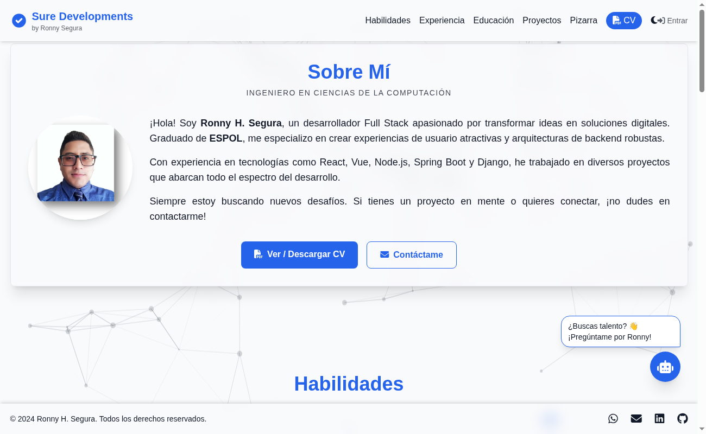

<div align="center">

# Ronny Segura · Portafolio y CV

**Ingeniero en Ciencias de la Computación · Desarrollador Full Stack**

[](https://portfoliowebsite-ccc81.web.app)
[](https://portfoliowebsite-ccc81.web.app/cv)
[](https://www.linkedin.com/in/rohusemer)


Portafolio personal con **constructor visual de CV**, **edición en vivo** protegida por roles y un **bot asistente**
que responde a reclutadores y les entrega el CV en PDF.

</div>

---



## ✨ Funcionalidades

| | |
|---|---|
| 🌐 **Portafolio público** | Perfil, habilidades, experiencia, estudios y proyectos en una línea de tiempo animada, con modo oscuro. |
| 💡 **Buzón de sugerencias** | Desde el bot, anónimo o con nombre. Llega a *Mensajes* (filtro *Sugerencias*) y por correo. |
| 🔔 **Avisos por correo** | Mensajes, sugerencias y solicitudes de permiso te llegan por email (FormSubmit, gratis). |
| 🔍 **SEO** | El HTML se genera con tu contenido real de Firestore, con `sitemap.xml`, `robots.txt` y datos estructurados *Person* (JSON-LD). |
| 🛡️ **Privacidad** | Página `/privacidad` (LOPDP Ecuador), consentimiento al registrarse y botón *Eliminar mi cuenta*. |
| 🤖 **Bot asistente** | Responde sobre mi experiencia y tecnologías (*"¿sabe React?"*), **se nutre de mis repositorios públicos de GitHub** (lenguajes, proyectos destacados, el más reciente), **entrega el CV en PDF** y recoge mensajes de contacto. |
| 🧩 **Constructor de CV** | Arrastrar y soltar bloques entre columnas, ocultarlos, renombrarlos, crear bloques propios y cambiar el color. Vista A4 en vivo con aviso si el contenido no cabe en una página. |
| 📄 **PDF publicado** | Un clic en *"Guardar y publicar PDF"* genera el CV y lo deja listo para que el bot lo entregue. |
| ✏️ **Edición en vivo** | Al iniciar sesión como admin aparece un botón *Editar* en cada sección del portafolio. |
| 🔑 **Registro y acceso** | Con **correo y contraseña** (foto obligatoria, verificación de correo, recuperación de contraseña) o con **Google**. Al entrar, cada usuario va a su propio CV, que empieza con datos de ejemplo hasta que lo edite. |
| 🌐 **Sitio web por usuario** | Cada usuario edita su propio sitio (vista previa en *Mi sitio web*). Con Premium lo publica en `/perfil?u=<uid>` junto a su CV. |
| 👥 **Usuarios y permisos** | Solo el administrador entra al panel: ve quién se registró, asigna roles y define **permisos por sección** (ver / editar / crear) sobre el CV de cada usuario. |
| 🖼️ **Subida de foto** | La foto se sube desde el equipo: se recorta, se reduce a 400×400 y se guarda sin necesidad de Firebase Storage. |
| 🙋 **Solicitudes de permiso** | Los usuarios piden un permiso especial (Premium o Editor) desde su panel o por correo; el administrador aprueba o rechaza. |
| 💳 **Plan Premium** | Precio y enlace de pago configurables (PayPal, PayPhone…). Premium da una página pública del CV para compartir. |
| 🪪 **CV para cada usuario** | Cada usuario tiene su espacio en `/mi-cv` para editar su información, armar su CV y descargarlo en PDF. |
| 📬 **Bandeja de mensajes** | Los mensajes que dejan los visitantes llegan al panel `/admin` con un contador de no leídos. |
| 📝 **Markdown en todo** | Las descripciones se escriben en Markdown y el CV se exporta también como `.md` o JSON. |

<table>
<tr>
<td width="62%"><br><sub><b>Constructor de CV</b>: bloques arrastrables y editor del bloque seleccionado</sub></td>
<td width="38%"><br><sub><b>CV en PDF</b> (A4, una página)</sub></td>
</tr>
</table>

## 🗺️ Rutas

| Ruta | Quién | Qué hace |
|---|---|---|
| `/` | Todos | Portafolio y bot. Con sesión de admin activa: **modo edición**. |
| `/cv` | Todos | El CV en línea, con descarga en PDF (el publicado), impresión y exportación a Markdown. |
| `/mi-cv` | Usuarios registrados | Su CV (información, diseño, PDF/Markdown) y **Mi cuenta** (solicitar permisos, página pública). |
| `/privacidad` | Todos | Política de privacidad y términos de uso. |
| `/perfil?u=<usuario>` | Todos | CV público de un usuario Premium, con descarga en PDF. |
| `/admin` | Solo el administrador | **Constructor de CV**, **Contenido web**, **Mensajes** y **Usuarios y permisos**. |

En el navbar aparece la pestaña **Panel** (solo el administrador) o **Mi CV** (usuarios) con la sesión iniciada.

## 🔐 Roles

| Rol | Panel, portafolio, PDF del bot, mensajes | Usuarios, permisos y planes | Su propio CV | Página pública |
|---|:-:|:-:|:-:|:-:|
| `owner` (administrador) | ✅ | ✅ | ✅ | ✅ |
| `premium` | — | — | ✅ | ✅ |
| `user` *(por defecto)* | — | — | ✅ | — |
| `blocked` | — | — | — | — |

- **El administrador es fijo**: su UID está en `firestore.rules` (`ownerUid()`) y en `PUBLIC_OWNER_UID`. No se puede asignar ni quitar desde la app, y aunque alguien escribiera `role: "owner"` en la base de datos, no obtendría ningún poder.
- Nadie puede cambiar su propio rol ni aprobar su propia solicitud: lo garantizan las reglas, no solo la interfaz.

### Permisos por sección (CV de cada usuario)
En **Usuarios y permisos → Permisos** el administrador decide qué puede hacer cada usuario en **su propio CV**
(Perfil, Contacto, Experiencia, Estudios, Habilidades, Proyectos, Idiomas, Hobbies, Diseño del CV, Descargar PDF y **Modo edición**, que le permite editar su sitio directamente sobre la vista previa; viene desactivado):

| Nivel | Qué permite |
|---|---|
| Sin acceso | La sección no aparece |
| Ver | Solo lectura |
| Editar | Modificar lo existente, sin agregar ni eliminar elementos *(valor por defecto)* |
| Crear y eliminar | Control total |

Las reglas de Firestore comprueban cada campo modificado contra estos permisos. Con "Editar", además, la lista no puede cambiar de tamaño.

### Monetización
1. En **Admin → Usuarios y permisos → Plan Premium** defines el precio, los beneficios y tu **enlace de pago** (PayPal.me, PayPhone, etc.).
2. El usuario paga desde **Mi cuenta**. El enlace incluye su ID como `client_reference_id`, y él pega la referencia de la transacción en su solicitud.
3. Verificas el pago en tu cuenta y pulsas **Aprobar**: el rol cambia al instante.

> La activación **automática** al pagar requiere un webhook del proveedor en Cloud Functions (plan Blaze de Firebase). La estructura ya está lista para añadirlo.

## 🛡️ Seguridad

| Capa | Cómo se resuelve |
|---|---|
| **Autenticación** | Firebase Auth: **correo y contraseña** o **Google (OAuth 2.0)**. Las contraseñas nunca pasan por nuestra base de datos: Firebase las guarda con hash **scrypt**. Exigimos mínimo 8 caracteres con letras y números, verificación de correo y recuperación por email. |
| **Tokens** | Cada petición lleva un **ID token JWT firmado por Google (RS256)** que caduca en 1 h y se renueva solo. Firestore verifica la firma en el servidor. |
| **Autorización** | [`firestore.rules`](firestore.rules): roles, validación de campos y tamaños, deny-by-default. Hay 61 pruebas automatizadas. |
| **Sesión** | Verificación de correo obligatoria antes de usar la cuenta (segundo paso del registro) y **cierre automático tras 30 min de inactividad** en los paneles. |
| **Cookies / CSRF** | La sesión no usa cookies (el token vive en IndexedDB y se envía como `Authorization: Bearer`), así que no hay superficie de CSRF. |
| **CORS** | El sitio es estático y habla directo con las APIs de Google, que gestionan su CORS. La API Flask heredada solo acepta los dominios del portafolio. |
| **Cabeceras HTTP** | `Content-Security-Policy`, `Strict-Transport-Security`, `X-Frame-Options: DENY`, `X-Content-Type-Options`, `Referrer-Policy`, `Permissions-Policy` y `COOP` ([`firebase.json`](firebase.json)). |
| **XSS** | Todo el Markdown pasa por **DOMPurify**, y la CSP limita los orígenes de scripts. |
| **Spam** | Validación en las reglas y un campo trampa (honeypot) en el formulario del bot. |

**Recomendado en la consola de Google Cloud:**
- Restringir la API key del navegador a tus dominios (*APIs y servicios → Credenciales*).
- Para un segundo factor con código (TOTP/SMS) hace falta *Identity Platform* (requiere el plan Blaze).
- Eliminar usuarios desde el panel borra sus datos en Firestore. Su cuenta de acceso solo se puede borrar desde *Authentication* en la consola (o con el Admin SDK). Para impedir el acceso, usa el rol **Bloqueado**.
- Activar **App Check** con reCAPTCHA para que solo tu web pueda usar Firestore.

## 🏗️ Arquitectura

```
Visitante ──► Firebase Hosting (Astro estático)
                 │
                 ├── Portafolio / CV ──────► Firestore: portfolio/main      (lectura pública)
                 ├── Bot ── "dame el CV" ──► Firestore: cvPdf/current/chunks (lectura pública)
                 │      └─ formulario ─────► Firestore: messages            (solo crear)
                 │
Usuario ──► Google Sign-In (JWT) ──► Firestore: users/{uid}.role
                                   ├── user    → profiles/{uid} (su CV) + roleRequests/{uid}
                                   ├── premium → + profiles/{uid} público (/perfil)
                                   └── owner (UID fijo) → + users, roleRequests, settings
```

- **Contenido**: un único documento `portfolio/main`. Si no existe, el sitio usa la semilla [`frontend/src/data/portfolio.json`](frontend/src/data/portfolio.json), por lo que nunca se ve vacío.
- **PDF**: se genera en el navegador del admin (html-to-image + jsPDF) y se guarda en Firestore dividido en trozos de 700 KB. No usa Firebase Storage, así que funciona en el plan gratuito.
- **Rendimiento**: los visitantes no descargan Firebase Auth, el editor ni el generador de PDF. Se cargan solo cuando hacen falta.
- **Bot**: funciona por reglas y palabras clave sobre los datos del portafolio (sin IA ni costo). Las respuestas personalizadas se editan desde `/admin`.

### Estructura

```
├── firebase.json            # Hosting + reglas
├── firestore.rules          # Modelo de permisos por rol
├── scripts/test-firestore-rules.mjs   # 61 pruebas de las reglas (emulador)
├── frontend/
│   ├── src/data/portfolio.json        # Contenido inicial (semilla)
│   ├── src/lib/                       # Firebase, sesión, Markdown, PDF, cerebro del bot
│   ├── src/components/react/
│   │   ├── PortfolioSections.tsx      # Secciones públicas + modo edición
│   │   ├── CvDocument.tsx             # El CV (bloques, columnas, modo constructor)
│   │   ├── ContactBot.tsx             # Bot asistente
│   │   ├── AuthButton.tsx             # Login en el header
│   │   ├── MyCvApp.tsx                # /mi-cv: CV personal de cada usuario
│   │   ├── AccountPanel.tsx           # Mi cuenta: solicitudes, pago, página pública
│   │   ├── PublicProfile.tsx          # /perfil: CV público (premium)
│   │   ├── NavPanelLink.tsx           # Pestaña "Panel" / "Mi CV" del navbar
│   │   └── admin/                     # Panel: constructor, editor, mensajes, usuarios, solicitudes, planes
│   └── src/pages/                     # /, /cv, /admin…
```

## 🚀 Puesta en marcha

**Requisitos:** Node 20+, [pnpm](https://pnpm.io), [Firebase CLI](https://firebase.google.com/docs/cli) (`firebase login`).

```bash
cd frontend
pnpm install
cp .env.example .env        # completa con: firebase apps:sdkconfig WEB
pnpm dev                    # http://localhost:4321
```

### Configuración de Firebase (una sola vez)

1. **Authentication** → *Método de acceso* → habilitar **Google** y **Correo electrónico/contraseña**.
2. **Firestore Database** → crear la base de datos en modo producción.
3. Publicar reglas: `firebase deploy --only firestore:rules`
4. **Administrador**: pon tu UID en `ownerUid()` de `firestore.rules` y en `PUBLIC_OWNER_UID` del `.env`. Tu UID aparece en *Authentication → Usuarios* después de iniciar sesión una vez. Despliega y listo: el resto de roles se asignan desde **Admin → Usuarios y permisos**.
5. En `/admin` pulsa **Guardar**, y en el *Constructor de CV* pulsa **Guardar y publicar PDF**.

### Despliegue

```bash
firebase deploy                  # build + hosting + reglas
firebase deploy --only hosting   # solo el sitio
```

> Los cambios de contenido y el PDF se publican **al instante** desde `/admin`. Para que **Google** vea el contenido nuevo, vuelve a
> desplegar (`firebase deploy --only hosting`): el build lee tu portafolio desde Firestore y lo incluye en el HTML.

## 🧰 Scripts

| Comando (en `frontend/`) | Descripción |
|---|---|
| `pnpm dev` | Servidor de desarrollo |
| `pnpm build` | Build estático en `frontend/dist` |
| `pnpm preview` | Sirve el build localmente |
| `pnpm check` | Verificación de tipos (`astro check`) |

Pruebas de las reglas de seguridad (desde la raíz, requiere Java):

```bash
firebase emulators:exec --only firestore --project demo-test "node scripts/test-firestore-rules.mjs"
```

## 💡 Flujo recomendado para actualizar el CV

1. Entra en el sitio → **Entrar** → menú del avatar → **Panel completo**.
2. En **Constructor de CV**, haz clic en un bloque para editarlo, o arrástralo para reordenarlo.
3. Escribe los logros con verbos de acción y cifras: `- Reduje un 40% el tiempo de generación de reportes…`
4. Revisa la **Vista previa PDF** y pulsa **Guardar y publicar PDF**. El bot ya entrega la versión nueva.

---

<div align="center">
<sub>Hecho con Astro, React, Tailwind y Firebase · © Ronny H. Segura</sub>
</div>
